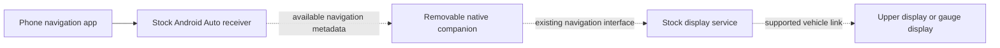

# Subaru XV firmware assessment

For the consolidated execution order, see the
[prioritized task backlog](task-backlog.md).

This is the initial assessment. The subsequent
[offline analysis results](offline-analysis-results.md) supersede its extraction
status and add verified signature bindings and traced display interfaces.
The later [wireless transport verification](wireless-android-auto-verification.md)
establishes that the bundled Android Auto projection transport is USB-only.

Assessed on 2026-10-30. The owner identifies the car as a 2017 Subaru XV.
An earlier owner statement said the supplied package was installed, but a later
system-information photo shows **`Rel_A2.25.15.20`**, while the supplied package
identifies itself as **`Rel_A2.24.41.20`**. The photo supersedes that assumption.
The owner has now supplied both packages. The
[version comparison](firmware-version-comparison.md) confirms identical relevant
receiver/wrapper/display/HMI files and repeats the static audits successfully
against `Rel_A2.25.15.20`. This initial assessment describes the older package;
runtime access and recovery are still unverified. No downgrade is required.
The exact head-unit part number and secondary display variants remain unknown.
The owner later confirmed that built-in TomTom turn instructions appear on both
the upper dashboard display and the display between the gauges.
This assessment does not establish whether Subaru has published a newer build.

## Conclusion

There is useful scope for research and potentially for native interface changes,
additional applications, and forwarding Android Auto navigation metadata. There
is **not yet a demonstrated way to install those changes on this firmware while
guaranteeing recovery to stock**. No installation or device writes were attempted.

The best first feature to investigate is forwarding turn instructions to an
existing navigation page on the upper multifunction display. It is a plausible
engineering project, not a feature proven available in this package. Preserving
the existing Android Auto receiver and adding a small, removable companion
process would be the preferred design if suitable runtime access is established.

## What the supplied files establish

`KaliSWDL.log` identifies:

| Field | Value |
| --- | --- |
| Market / variant | EU |
| Product tier | High |
| Build | `Rel_A2.24.41.20` |
| Build year / week / patch | 24 / 41 / 20 |
| Platform model-year label | MY2017 |
| Build workspace | Subaru Gen3.0, Ver6.5 |
| Map update mode | PORTAL |

These are package labels; MY2017 is not a reliable identification of every car
or head unit supported by the package. The build-year field indicates 2024,
not that the firmware was necessarily installed or released that year.

Unlike the i.MX6 base unit in the original write-up, the ISO includes
`ifs/ifs-dra74x-subaru.bin` and `ifs/mlo`. Build paths identify `j6` and
`qnx6/armle-v7`; startup strings identify QNX 660, J6, and Cortex-A15. This is
evidence for the TI DRA74x/Jacinto 6 high-unit platform, not an Android OS.
Installing ordinary Android APKs is therefore not a native extension mechanism.

The ISO contains 83 regular files. The standalone `minifs.ifs` yielded 252
regular files, 52 symlinks and 5 directories; `rvcfs.ifs` yielded 63 regular
files, 33 symlinks and 1 directory. Only regular files were extracted. Embedded
and standalone copies of `installUpdate.sh` are byte-identical.

| Payload | Size, MiB | Interpretation and research priority |
| --- | ---: | --- |
| `swdl.iso` | 69.89 | Update environment, boot images, RH850 binaries, map updater and supporting files. Critical to understanding writes and authentication. |
| `system.dat` | 220.05 | QNXCNDFS system payload; likely the main application research target. Contents have not been decrypted or inventoried. |
| `swupdate.dat` | 31.74 | QNXCNDFS update payload. Relevant to recovery; contents not yet inventoried. |
| `navsw.dat` | 63.58 | QNXCNDFS navigation software payload. Keep in scope for discovering the built-in navigation/display interface. |
| `misc.dat` | 2322.23 | QNXCNDFS payload of unverified contents. Do not classify it as disposable map data. |
| `gracenote.dat` | 922.05 | QNXCNDFS payload, likely the media identification database from its name. Low initial priority. |
| `map/content/map.dat` | 10652.80 | Separate map payload, accompanied by map licenses and signatures. Low priority for feature development. |

The first five top-level DAT files have QNXCNDFS headers. `system.dat`,
`swupdate.dat` and `navsw.dat` have value 3 at header offset 0x0c; `misc.dat`
and `gracenote.dat` have value 0. This does not by itself establish the
cryptographic coverage or validity of any payload. No DAT decryption or
repacking has been performed. The main startup IFS indicates LZO compression;
the added extractor deliberately supports only standalone uncompressed imagefs.

## Recovery and bootloader implications

The original [research write-up](README.md) describes 2017-era firmware and a
signature-verification flaw disclosed in 2018. Its note from Harman says the
updater was intended to authenticate the DAT files. Its successful downgrades
and unsigned-image installation are historical results, not validation of
this 2024 build. Neither vulnerability nor remediation was proven here.

There is direct evidence that boot components are part of this update:

- `ifs/mlo` is a main-processor early boot component.
- `ifs/ifs-dra74x-subaru.bin` contains startup/OS components that can prevent
  normal startup even if the earlier loader is intact.
- Each of five RH850 directories includes `subioc.bin`, `subioc_bolo.bin` and
  `subioc_blupdater.bin`. `miniFS/usr/rh850Config.json` maps vehicle variants to
  application, bootloader and bootloader-updater files.
- Extracted `miniFS/bin/installUpdate` contains messages for updating MLO and
  IFS in first and second boot partitions, and for comparing and updating the
  IOC/RH850 bootloader. It also contains partition deletion/creation commands.

These observations establish possible operations, not that every normal update
runs every operation. Their conditions and destinations need disassembly before
any modified update could be considered.

The same updater includes `EVP_DigestVerifyInit` / `EVP_DigestVerifyFinal`
imports, ISO signature-verification messages, an invalid-DAT intrusion message,
an older-version refusal message, and the path `/etc/enableDowngrade`.
These are leads for code analysis. They do not prove a usable downgrade switch,
a particular authentication bug, or successful reinstalls of the same version.
Finding two boot copies also does not prove an independent, working A/B recovery
system; the updater has messages for writing both.

The stock ISO matches its supplied MD5:

```text
MD5     f4d5e7ab58d42e2653498b9acce20340
SHA-256 daae20c361687740a0ba1d6e73b53f6ee04f2598730a523a1da7f1013205555b
```

This verifies consistency with the supplied checksum, not Subaru authenticity
or device recovery. Recalculating MD5 cannot replace an OEM digital signature.
Decrypting a payload would likewise not establish permission to run modified code.

To satisfy the recovery requirement before device changes, establish:

1. The exact unit/board revision, storage layout and all update write targets.
2. A verified stock backup including required eMMC user and boot areas,
   partition/configuration information, and unit-specific provisioning,
   calibration and licenses. A USB update is not a complete device backup.
3. A recovery mechanism that works when the main application or OS cannot boot,
   together with a demonstrated restore procedure on a matching spare unit.
   Hardware access details and feasibility are still unknown.
4. Acceptance of the intended stock version after a change, including version
   checks and any persistent-data migrations.
5. A way to add and disable an extension without writing MLO, startup IFS,
   recovery/update components, partition tables or RH850 firmware.

Even an unchanged bootloader cannot guarantee recovery if the code that launches
USB recovery, or the filesystem it requires, stops working. If “always return to
stock” is absolute, the presently defensible scope is offline work and phone-side
features; head-unit modifications must wait for demonstrated recovery.

## Android Auto and the other screens

Keep Android Auto as a protected dependency. A native QNX extension should use
observed interfaces around the OEM receiver rather than replace its projection,
USB, audio or Bluetooth implementation. If the required data is unavailable
through an existing interface, more invasive receiver changes may be necessary;
those would require a new assessment.

Android Auto can carry navigation information for secondary displays. Google's
[navigation app documentation](https://developer.android.com/training/cars/apps/navigation)
describes supplying trip information for cluster/HUD use, and drawing maps on
supported clusters. This is platform capability, not confirmation that this
older Harman receiver requests or exposes it. The public app API is not a
general API for reading another application's Google Maps/Waze route.

The [open-android-auto project's navigation-channel research](https://github.com/mrmees/open-android-auto/blob/main/docs/channels/nav.md)
also documents turn and distance messages and capability negotiation. It is
independent protocol research, not an OEM specification or proof for this unit.
Android Automotive OS cluster APIs should not be treated as QNX APIs.

Subaru's contemporary [European XV brochure, PDF page 8](https://subaru.fr/docs/brochures/Documentation_2018_Subaru_XV.pdf)
describes navigation instructions on the upper 6.3-inch multifunction display,
depending on trim. This makes the built-in navigation-to-display path a useful
target. It does not identify the owner's installed display hardware or establish
Android Auto forwarding. The display between the gauges needs separate analysis.

| Desired change | Assessment |
| --- | --- |
| Track title / artist on an existing audio page | Plausible if projection metadata and the display's existing audio interface are accessible; first check current behavior. |
| Turn arrow and distance on the upper display | Most promising navigation experiment if the stock navigation already displays them. Requires both receiver metadata and a compatible output interface. |
| Road name, ETA or lane guidance | Conditional on the data supplied by the receiver and fields supported by that display. |
| Turn instructions between the gauges | Unconfirmed; the upper display and gauge display may accept different information. |
| Full Android Auto map/video on either extra screen | Much less certain. Requires a graphics/video path and display support; root access alone cannot provide those. |

A proposed architecture, with every connection still to be verified:



Investigate QNX PPS and D-Bus service interfaces first, then the existing vehicle
display transport. CAN, a private serial link or another transport are hypotheses
until identified; generic CAN messages cannot be assumed to control these screens.
Initially observe existing built-in navigation behavior rather than transmit
experimental messages onto the car's networks.

If the receiver exposes no metadata, a phone companion could provide information
from its own navigation integration. Reading notification text is a possible
prototype source but is fragile and permission-dependent. It still needs a
verified path to the stock displays; a separate external display would avoid
head-unit firmware changes entirely.

## What can be developed

Once access and recovery are established, feasible development targets include
native ARM/QNX utilities, data logging and export, a small navigation or media
metadata bridge, and selected UI/configuration changes where replaceable assets
or interfaces exist. Native applications need a compatible QNX toolchain and
the unit's actual libraries/ABI. Theme and boot-logo changes have different
risks: a logo inside the startup IFS conflicts with the protected boot scope.

Wireless Android Auto or a replacement projection receiver would be a much
larger compatibility project and is not established by discovering Wi-Fi hardware.
No existing patch, ready-to-flash custom firmware or working root method for this
build has been produced by this assessment.

Android Auto acceptance checks on a bench unit should cover launch/reconnect,
music and navigation audio focus, calls and microphone, steering-wheel controls,
sleep/wake, and reverse-camera priority. Test that disabling the companion restores
the observed stock behavior, including when the companion crashes.

## Map scope

Leave the large map database and its licenses unchanged. They are unnecessary
for initial interface research. `installUpdate.sh` starts the map authentication,
SyncTool and NavUpdateController path conditionally when the map payload exists;
the configuration separates map storage and licensing from the system payload.

However, that condition does **not** prove that deleting maps from a flashable
package is accepted: `installUpdate` separately contains a map-availability
validation message. Keep the complete stock package intact. Keep `navsw.dat`,
navigation libraries and display services in the research scope because they
may reveal the output interface we want to reuse. A map database and a navigation
service are different dependencies.

## Reproducing the completed offline work

The added [inspection script](../tools/inspect_firmware.py) uses the Python standard
library. It hashes input files, inventories headers, and extracts regular files
from standalone uncompressed imagefs images. It never executes the firmware,
recreates embedded symlinks, repacks images or accesses a head unit. It does not
validate OEM signatures or IFS checksums. The imagefs layout reference is
[the header linked by the original dumpifs project](https://github.com/askac/dumpifs/blob/master/sys/image.h).

From the repository root, using new output paths for each run:

```powershell
python tools/inspect_firmware.py inventory usbUpdateStock_Rel_A2.24.41.20/KaliSWDL analysis/stock-inventory.json --hash-maps
New-Item -ItemType Directory -Force analysis/stock-iso | Out-Null
tar -tf usbUpdateStock_Rel_A2.24.41.20/KaliSWDL/swdl.iso
# Inspect the listing before extracting an unfamiliar ISO.
tar -xf usbUpdateStock_Rel_A2.24.41.20/KaliSWDL/swdl.iso -C analysis/stock-iso
python tools/inspect_firmware.py ifs analysis/stock-iso/updateOS/minifs.ifs analysis/minifs
python tools/inspect_firmware.py ifs analysis/stock-iso/updateOS/rvcfs.ifs analysis/rvcfs
```

The full 17-file hash inventory is in `analysis/stock-inventory.json`; extracted
file metadata and hashes are in `analysis/minifs/manifest.json` and
`analysis/rvcfs/manifest.json`. All 315 extracted regular-file hashes were
checked against their source image slices. `analysis/` is ignored by Git to
avoid adding proprietary firmware and extracted licensing material to the repo.

The next useful steps are offline analysis of the application's filesystem and
the updater's authentication/write paths, followed by read-only observation on
identified hardware. The decisive missing evidence is a demonstrated recovery
path and the actual receiver-to-secondary-display interfaces.
