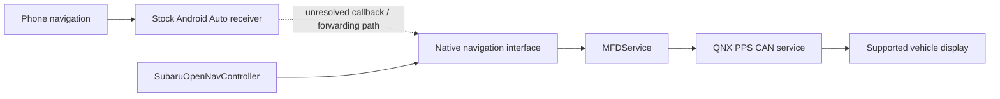

# Offline analysis: application extraction and display interfaces

Follow-up to [the initial assessment](firmware-assessment.md), completed on
2026-10-30 against the supplied EU High `Rel_A2.24.41.20` package.

The owner subsequently supplied the matching `Rel_A2.25.15.20` package as well.
The relevant receiver, wrapper, display-service, HMI and navigation files are
byte-identical, and the static audits pass against its extraction. See the
[version comparison](firmware-version-comparison.md). The historical results
below describe the first package; runtime and recovery remain unverified.

A subsequent [wireless transport audit](wireless-android-auto-verification.md)
traced an explicit USB-only protocol gate and transport constructor in the
bundled Android Auto receiver. Native wireless is absent from that stock path;
the Wi-Fi hardware's potential for a replacement implementation remains unknown.

## Result

The system, updater and navigation software filesystems can now be extracted
offline. The supplied Android Auto receiver includes turn/distance callback code,
and the native Subaru multifunction-display service has a traced navigation
output path. These findings make a metadata bridge a concrete research target.
They do not establish an installable modification or guaranteed recovery.

The owner subsequently confirmed that built-in TomTom turn instructions appear
on **both the upper dashboard display and the display between the gauges**.
This is an owner observation, not a captured bus trace. It confirms existing
navigation-display capability on both installed screens. Reusing those stock
paths is therefore the target; the transport details and Android Auto connection
still need validation separately for each display.

No firmware was installed, repacked or patched. During this initial extraction,
the only emulated firmware code was a hash-pinned, pure decompression routine
with no QNX system/device access. A later
[navigation investigation](navigation-bridge-progress.md#endpoint-setup-and-bounded-dispatch-probes)
also probes three isolated callback dispatch routines with synthetic inputs;
it does not boot QNX or emulate OS services/devices.
Stock files remain unchanged; rehashing the three analyzed encrypted payloads and
the ISO confirms their original baseline hashes.

## Extracted files and validation

The main startup image uses LZO1X blocks. Decompression produced a 13,635,372-byte
imagefs with a valid additive checksum; the final compressed block has 61,652
bytes of zero padding. It yielded 198 regular files, including startup scripts
and the material the stock updater uses for payload decryption.

The payload key transformation was recovered from `installUpdate` at
`0x8052fc4`. The package salt is 15. No secret key material is included in these
notes or in the tools. The tools read it from the locally extracted stock image.

The bundled CNDFS implementation uses a different LZO variant from the startup
image. The extractor runs only its decompression routine under Unicorn, with
bounded buffers/instruction counts and an interrupt rejection hook. A SHA-256
pin rejects any different decoder binary. This avoids running the updater or
requiring a QNX VM.

| Payload | AES-GCM clusters verified | Restored populated bytes | QNX6 regular files |
| --- | ---: | ---: | ---: |
| `system.dat` | 462 | 484,261,888 | 1,213 |
| `swupdate.dat` | 84 | 87,989,248 | 59 |
| `navsw.dat` | 119 | 123,968,512 | 1 |

All three filesystem images passed both QNX6 superblock CRC checks. The reader
uses the extent map to restore data at its proper offsets; concatenating decoded
clusters alone would produce an incorrect filesystem. Symlinks and special files
are recorded in manifests, not recreated on Windows.

The reader's format references are the Linux project's
[QNX6 on-disk definitions](https://github.com/torvalds/linux/blob/v6.12/include/linux/qnx6_fs.h)
and [filesystem reader](https://github.com/torvalds/linux/blob/v6.12/fs/qnx6/inode.c).

`system.dat` contains five more imagefs payloads; `navsw.dat` contains `nav.ifs`.
All eight standalone imagefs images examined in this pass, including the two
update/reverse-camera images from the first pass, passed their additive checksums.

| Image | Extracted regular files | Output |
| --- | ---: | --- |
| `core1.ifs` | 47 | `analysis/core1/files` |
| `sys1.ifs` | 603 | `analysis/sys1/files` |
| `hmi1.ifs` | 988 | `analysis/hmi1/files` |
| `second1.ifs` | 151 | `analysis/second1/files` |
| `third1.ifs` | 12 | `analysis/third1/files` |
| `nav.ifs` | 1,277 | `analysis/navifs/files` |

All 59 files recovered from `swupdate.dat` match independent copies in the ISO's
`updateOS` directory. This is a useful independent check of the decryption,
decompression, extent restoration and filesystem reader.

## What is authenticated

The ISO signature was verified under `SubaruPubkey.pmem`, extracted from the
supplied boot image. It is RSA-2048 PKCS#1 v1.5 with SHA-256:

- File bytes `0x0000..0x00ff` contain the signature.
- The signed message is bytes `0x0100..0x7fff`.
- The SHA-256 of the ISO body from `0x8000` to EOF matches the digest at `0x7fe0`.
- The signed header also contains matching CNDFS header digests for five DAT files.

| Payload | Reference offset in the ISO |
| --- | --- |
| `system.dat` | `0x11a` |
| `swupdate.dat` | `0x13a` |
| `navsw.dat` | `0x15a` |
| `misc.dat` | `0x17a` |
| `gracenote.dat` | `0x19a` |

For all five DATs, SHA-256 checks passed for the 512-byte header with its digest
field zeroed, the extent table, and the cluster table. Together with all 665
encrypted-cluster authentication checks for the three extracted payloads, this
establishes the package's cryptographic consistency. It is **not independent OEM
provenance verification**: the public trust anchor came from the supplied package.

The reviewed updater has a non-ISO path at `0x805e8e2` that obtains a DAT's stored
header digest through `0x805c076` and compares it with a reference obtained through
`0x805bfac`. For this CNDFS version, the stored header digest is at offset `0x68`.
That digest is now demonstrably represented in signed ISO metadata. This is
stronger evidence than strings alone that the old repacking approach should not
be assumed to work. It is not an exhaustive audit of every installer branch.

Decryption enables inspection; it does not supply the OEM signing private key or
a validated way to install modified content. No verification bypass was built.

## Android Auto: endpoints exist, connection remains unresolved

Follow-up: [navigation bridge progress](navigation-bridge-progress.md) now traces
the reviewed wrapper's three null navigation slots through the receiver table
copy and endpoint gate. It includes a reproducible hash-pinned audit and a
semantic PC replay prototype. Other registration paths and runtime behavior
remain unverified; the discussion below records the earlier investigation.

The relevant components are now identified:

| Component | Extracted location | Evidence |
| --- | --- | --- |
| Stock projection controller | `analysis/second1/files/second1/bin/projectionService` | Projection/audio integration and subscriptions |
| Subaru Android Auto wrapper | `analysis/second1/files/second1/lib/libGALSVC.so` | Cinemo callback registration and navigation-focus handling |
| Android Auto receiver | `analysis/second1/files/second1/MediaOne/cinemo/libNmeAndroidAuto.so` | Navigation endpoint registration, status, next-turn and distance callbacks |
| Native navigation producer | `analysis/navifs/files/nav/OpenNav/SubaruOpenNavController` | NavigationCluster service and next-turn signal identifiers |
| Display consumer | `analysis/second1/files/second1/bin/MFDService` | Native signal subscriptions, JSON parsing and output |
| Native HMI | `analysis/hmi1/files/hmi/Andromeda` | Interface executable and separate image assets |

The receiver includes `OnNavigation_Status`, `OnNavigation_NextTurn` and
`OnNavigation_NextTurnDistance`, plus explicit checks that prevent registering
a navigation endpoint when callbacks or required metadata are absent. This is
direct evidence of capability in the bundled receiver, not proof that the
running Subaru configuration requests that capability.

The reviewed wrapper function at `0x16a1c` clears a callback structure and fills
session, focus, audio, video, Bluetooth and media callback fields. No explicit
next-turn or distance callback was identified in that function. The complete
callback ABI and other possible registration paths still need tracing, so this
does not prove that navigation metadata is unavailable at runtime.

`GALSVC.cfg` sets `GetNavData` to true for Subaru High and false for Mid/Base.
Nearby code and sensor paths show vehicle GPS/gyro/accelerometer data being
reported **to the phone**. This setting must not be interpreted as a switch for
forwarding phone turn instructions to the dashboard. Likewise, `NmeNavAndroidAuto`
is a Cinemo navigator class name, not proof of turn-by-turn display integration.

## Native display interface traced in code

`MFDService` subscribes to `com.harman.service.NavigationCluster`. Its subscription
setup at `0x80642ec` associates `navClusterNextTurnInfo` with handler `0x8063e90`.
That handler pairs JSON fields with these PPS attributes:

| Input field | PPS attribute |
| --- | --- |
| `interruptFlag` | `AVN6B3_1_4_TBT_INTERRUPT_NOTICE` |
| `category` | `AVN6B3_2_4_TBT_CATEGORY` |
| `rotaryAvailable` | `AVN6B3_3_7_TBT_ROTELY` |
| `segment` | `AVN6B3_3_6_TBT_ROAD_SEGMENT` |
| `turnIcon` | `AVN6B3_3_0_TBT_DIRECTION` |

The native spelling `ROTELY` is preserved. The output routine at `0x806dde0`
opens `/pps/can/send` and writes the constructed string. Navigation therefore
has a traced software path toward the vehicle CAN service; there is no need to
start by guessing raw CAN frames.

Additional handlers consume navigation state, destination distance/arrival data,
heading and speed-limit information. The service also registers `sendMFDRoadInfo`
and `sendMFDLaneInfo`; the road-info handler parses `type`, `color` and `text`.
The executable includes both PPS/CAN and IOC IPC interfaces, so these should not
be treated as one interchangeable transport. There is also an existing
projection-audio metadata path and a meter-cluster input path.

The observed contract and code addresses are recorded in
[android-auto-display-interfaces.json](android-auto-display-interfaces.json).
**Enum meanings, unit/scaling rules, arbitration, timing and the actual display
variants are not yet validated.** The JSON file is a research index, not a
ready-to-transmit message specification.



## Recovery findings are firmer, but recovery remains unproven

The boot scripts establish these dependencies and observed storage mappings:

| Mount / purpose | Script evidence |
| --- | --- |
| `/fs/system` | `/dev/emmc0t177`, mounted read-only by `startDVFS.sh` |
| `/fs/data` | `/dev/emmc0t177.1` |
| `/fs/swupdate` | `/dev/emmc0t177.2` |
| `/fs/gracenote` | `/dev/emmc0t177.3` |
| `/fs/apps` | `/dev/emmc0t177.4` |
| `/fs/misc` | `/dev/emmc0t177.5` |
| `/fs/navsw` | `/dev/emmc0t177.6` or `/dev/emmc1t177.1` |

These are supported script paths, not a measured partition table from the car.
`startDVFS.sh` mounts the system and core image before `checkForUpdate.sh` runs.
`checkForUpdate.sh` then checks `/fs/data/update_mode`, prepares eMMC access,
mounts the USB ISO and starts the update environment. This is not a demonstrated
recovery mechanism independent of the normal QNX startup dependencies.

`updateIPLInEMMCBootArea.sh` explicitly writes both `/dev/boot0` and `/dev/boot1`.
The boot-area configuration script changes eMMC boot settings. Neither script was
executed. Existing formatting scripts are also factory/service tools, not backup
or recovery instructions.

The extracted current `passwd` has root/logger/certifier entries; it lacks the
passwordless daemon/dm accounts used by the original research. Root credentials,
an authenticated shell, downgrade acceptance and hardware recovery have not been
established for the owner's unit.

## Reproduction and checks

Install analysis dependencies inside the ignored workspace directory:

```powershell
python -m pip install --target analysis/python-deps --only-binary=:all: -r tools/requirements-firmware.txt
$env:PYTHONPATH = (Join-Path (Get-Location) 'analysis/python-deps')
```

Using new output paths, after the ISO/minifs extraction from the initial pass:

```powershell
python tools/inspect_firmware.py startup-ifs analysis/stock-iso/ifs/ifs-dra74x-subaru.bin analysis/mainifs
python tools/verify_stock_auth.py usbUpdateStock_Rel_A2.24.41.20/KaliSWDL analysis/verified-stock-authentication.json
python tools/extract_cndfs.py usbUpdateStock_Rel_A2.24.41.20/KaliSWDL/system.dat analysis/system
python tools/extract_qnx6.py analysis/system/filesystem.qnx6 analysis/system-files
python tools/inspect_firmware.py ifs analysis/system-files/files/ifs_images/second1.ifs analysis/second1
```

The same extraction commands were applied to `swupdate.dat`, `navsw.dat`, the
other system IFS files and `nav.ifs`. Existing output directories are deliberately
rejected. Decrypted images, keys, manifests, disassemblies and dependency packages
remain under ignored `analysis/`.

Validation records are in `analysis/verified-stock-authentication.json`,
`analysis/research-summary.json` and `analysis/validation-results.json`. Negative
checks rejected a changed decoder, a changed CNDFS header, a changed imagefs,
a changed AES-GCM tag and an output path inside the stock tree. All tools compile.

## Next milestone

Continue offline with the receiver's callback ABI and the wrapper's endpoint
registration. In parallel, identifying which stock navigation information already
appears on each display beyond the confirmed turn instructions will help define
the bridge's scope. Both displays are now confirmed targets for stock-path reuse.
The first on-unit milestone should be read-only observation of stock navigation
and Android Auto metadata through an established diagnostic connection.

No firmware installation is justified by this pass. A removable companion remains
the preferred design, but it requires an authenticated runtime execution path,
capture-validated interfaces and an independently demonstrated restore procedure.
